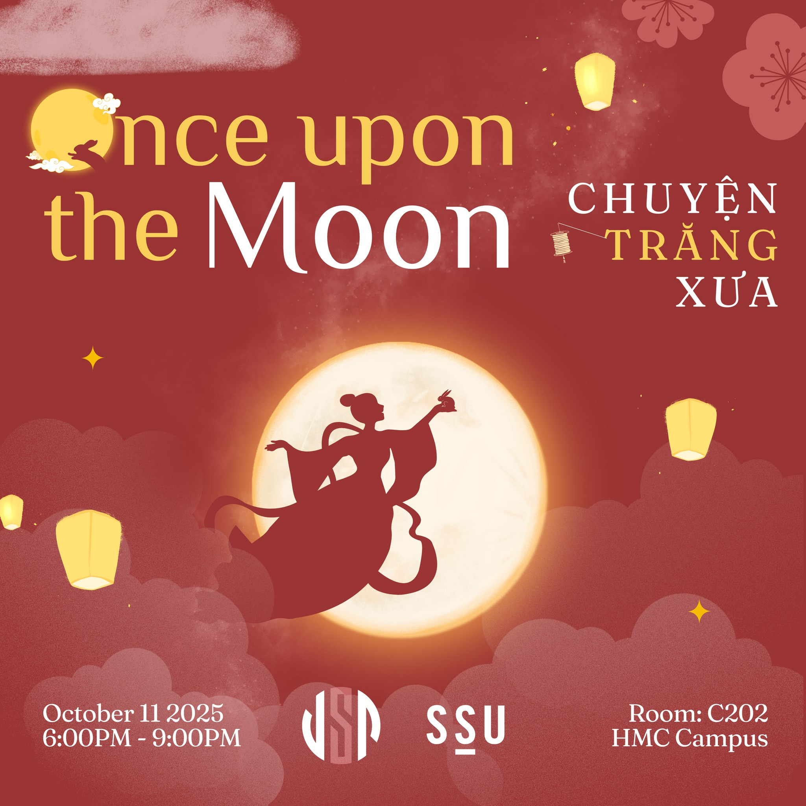

# Welcome to VSA at Sheridan College!

We are thrilled to have you here! The **Vietnamese Student Association (VSA)** at Sheridan College is dedicated to helping Vietnamese students adapt to life abroad and engage in building a vibrant community. Our mission is to provide support, foster connections, and create opportunities for personal and professional growth. Join us to make the most of your experience at Sheridan College and beyond!

---


🌕 [𝗠𝗶𝗱-𝗔𝘂𝘁𝘂𝗺𝗻 𝗙𝗲𝘀𝘁𝗶𝘃𝗮𝗹 𝗘𝘃𝗲𝗻𝘁 𝟮𝟬𝟮𝟱] Once Upon the Moon - An Old Tale of the Moon 🌕 

Hey VSA fam! How’s Fall semester going so far? 😩 You probably need a little break to de-stress and maybe make some new friends too, right?

Oh, and here’s a fun question for you: Which mooncake team are you on – mung bean, mixed filling, or do you love them all? 🍵🥮 Drop a comment below so we know!

🔥 No matter which team you’re on, don’t hesitate to join us at this event 🎉🥮

📅 Time: 6:00 PM – 9:00 PM, Saturday, October 11, 2025
📍 Location: Room C202, HMC Campus
👥 Registration link: https://forms.gle/jrkXxTYq1GPcy6KN7

(Form closes at 11:59 PM, October 5, 2025)

Don’t miss out! Tag your friends and sign up now to “light the lanterns” with us 🌙✨

---

Ây dô các bạn VSA ơi! Kỳ Fall này các bạn học như thế nào rồi nè? 😩 Chắc hẳn các bạn cần một khoảng thời gian để xả stress, cũng như kết bạn thêm những bạn mới đúng không?

À mà nè, VSA có câu hỏi nho nhỏ dành cho bạn: Bạn thuộc team nào á - đậu xanh hay thập cẩm hay là vị nào cũng cân hết? Comment ở dưới để tụi mình biết nhé!

🔥 Dù bạn ở team nào đi chăng nữa thì đừng ngần ngại tham gia sự kiện cùng tụi mình nhé 🎉🥮

📅 Thời gian: 6:00 PM - 9:00 PM, Thứ 7 11/10/2025
📍 Địa điểm: Room C202, HMC Campus
👥 Link đăng ký tham gia: https://forms.gle/jrkXxTYq1GPcy6KN7

Tụi mình đóng form vào lúc 11:59PM, ngày 5/10/2025

Đừng bỏ lỡ đó! Tag bạn bè và đăng ký ngay để cùng "rước lồng đèn" với tụi mình nhé 🌙✨ 


  
